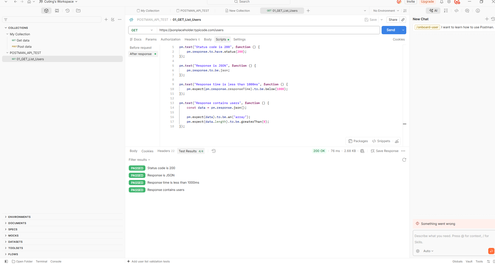
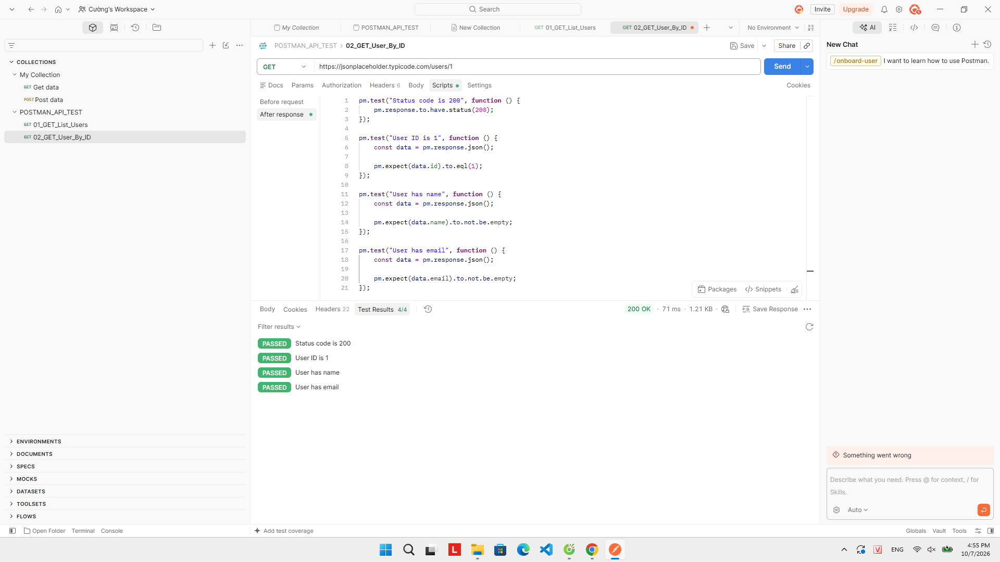
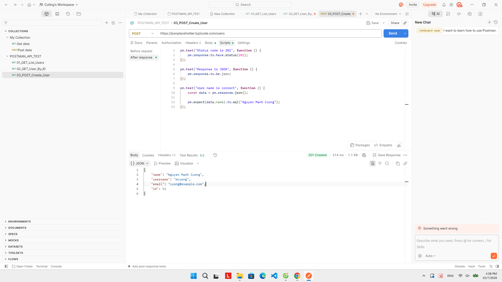
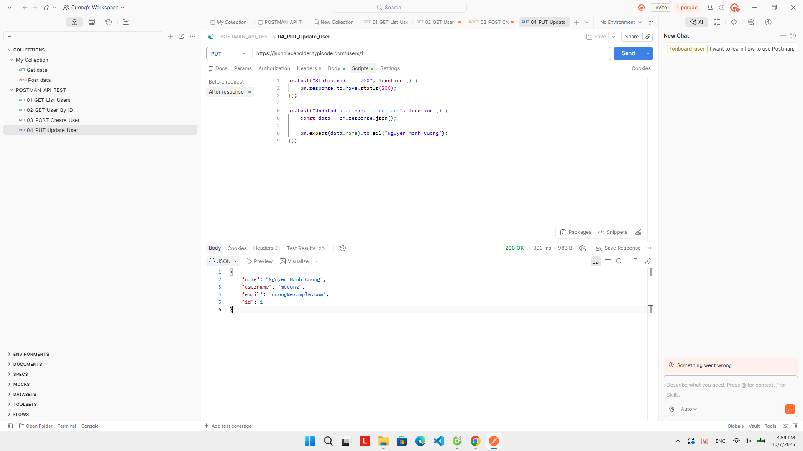
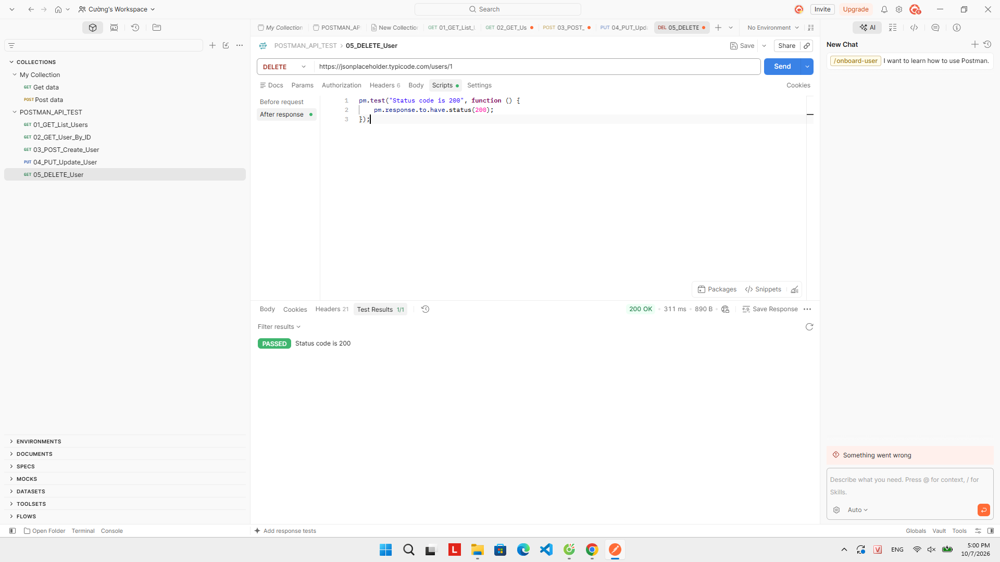
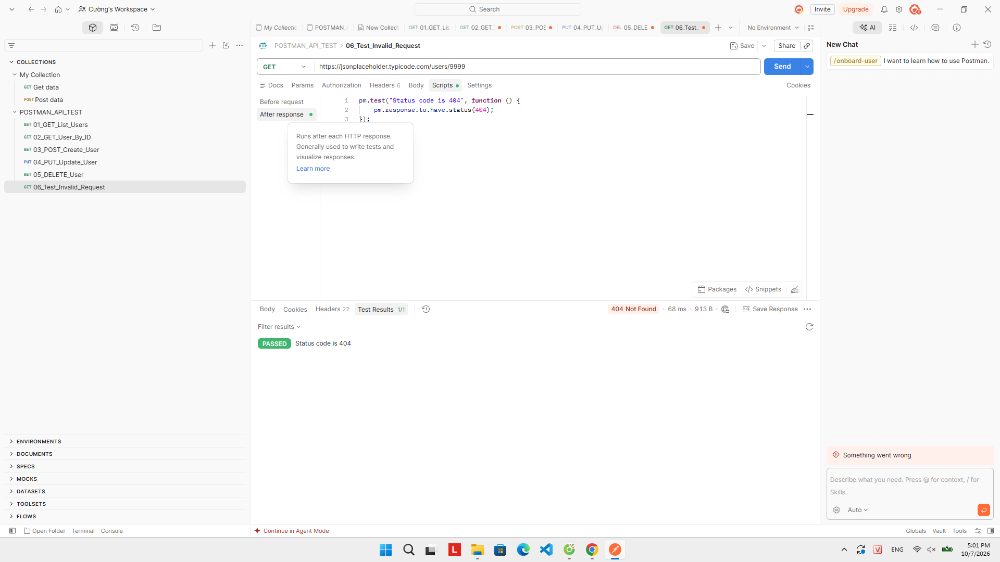

# BÁO CÁO THỰC HÀNH KIỂM THỬ API BẰNG POSTMAN

## 1. Thông tin sinh viên

- Họ và tên: Nguyễn Mạnh Cường
- Mã sinh viên: 23010271
- Công cụ sử dụng: Postman
- API sử dụng: JSONPlaceholder
- Repository: POSTMAN_API_TEST

---

## 2. Mục tiêu bài thực hành

Bài thực hành nhằm giúp sinh viên làm quen với công cụ Postman và thực hiện kiểm thử các API cơ bản.

Các nội dung đã thực hiện:

- Tạo Collection trong Postman.
- Tạo các request API.
- Thực hiện các phương thức GET, POST, PUT và DELETE.
- Kiểm tra Status Code của API.
- Kiểm tra dữ liệu trả về dạng JSON.
- Viết Test Script bằng JavaScript.
- Kiểm tra thời gian phản hồi của API.
- Kiểm thử trường hợp API trả về lỗi 404.
- Export Collection để lưu trữ và nộp bài.

---

## 3. Công cụ và API sử dụng

### 3.1. Postman

Postman là công cụ được sử dụng để gửi các HTTP Request đến API và kiểm tra Response trả về.

Trong bài thực hành, Postman được sử dụng để kiểm thử các API GET, POST, PUT và DELETE.

### 3.2. JSONPlaceholder

JSONPlaceholder là một API giả lập được sử dụng để thực hành các thao tác với REST API.

URL:

```text
https://jsonplaceholder.typicode.com
```

---

# 4. Nội dung thực hành

## 4.1. GET danh sách người dùng

### Request

```text
GET https://jsonplaceholder.typicode.com/users
```

### Test Script

```javascript
pm.test("Status code is 200", function () {
    pm.response.to.have.status(200);
});

pm.test("Response is JSON", function () {
    pm.response.to.be.json;
});

pm.test("Response time is less than 1000ms", function () {
    pm.expect(pm.response.responseTime).to.be.below(1000);
});

pm.test("Response contains users", function () {
    const data = pm.response.json();

    pm.expect(data).to.be.an("array");
    pm.expect(data.length).to.be.greaterThan(0);
});
```

### Kết quả

- Status Code: 200 OK.
- Response trả về dữ liệu dạng JSON.
- Thời gian phản hồi nhỏ hơn 1000ms.
- Dữ liệu trả về là một danh sách người dùng.
- Các Test Script đều PASS.

### Hình ảnh minh họa



---

## 4.2. GET người dùng theo ID

### Request

```text
GET https://jsonplaceholder.typicode.com/users/1
```

### Test Script

```javascript
pm.test("Status code is 200", function () {
    pm.response.to.have.status(200);
});

pm.test("User ID is 1", function () {
    const data = pm.response.json();

    pm.expect(data.id).to.eql(1);
});

pm.test("User has name", function () {
    const data = pm.response.json();

    pm.expect(data.name).to.not.be.empty;
});

pm.test("User has email", function () {
    const data = pm.response.json();

    pm.expect(data.email).to.not.be.empty;
});
```

### Kết quả

- Status Code: 200 OK.
- ID người dùng trả về là 1.
- Response có thông tin tên người dùng.
- Response có thông tin email.
- Các Test Script đều PASS.

### Hình ảnh minh họa



---

## 4.3. POST tạo người dùng

### Request

```text
POST https://jsonplaceholder.typicode.com/users
```

### Dữ liệu gửi lên

```json
{
    "name": "Nguyen Manh Cuong",
    "username": "mcuong",
    "email": "cuong@example.com"
}
```

### Kết quả

- Status Code: 201 Created.
- API nhận dữ liệu thành công.
- Response trả về dữ liệu dạng JSON.
- Thông tin người dùng được trả về trong Response.
- Các Test Script đều PASS.

### Hình ảnh minh họa



---

## 4.4. PUT cập nhật người dùng

### Request

```text
PUT https://jsonplaceholder.typicode.com/users/1
```

### Kết quả

- Status Code: 200 OK.
- API nhận request cập nhật thành công.
- Response trả về thông tin sau khi cập nhật.
- Test Script kiểm tra kết quả thành công.

### Hình ảnh minh họa



---

## 4.5. DELETE người dùng

### Request

```text
DELETE https://jsonplaceholder.typicode.com/users/1
```

### Test Script

```javascript
pm.test("Status code is 200", function () {
    pm.response.to.have.status(200);
});
```

### Kết quả

- Status Code: 200 OK.
- Request DELETE được thực hiện thành công.
- Test kiểm tra Status Code trả về PASS.

### Hình ảnh minh họa



---

## 4.6. Kiểm thử trường hợp không tồn tại

Để kiểm tra trường hợp API không tìm thấy người dùng, sử dụng ID không tồn tại.

### Request

```text
GET https://jsonplaceholder.typicode.com/users/9999
```

### Test Script

```javascript
pm.test("Status code is 404", function () {
    pm.response.to.have.status(404);
});
```

### Kết quả

- Status Code: 404 Not Found.
- API trả về lỗi do người dùng có ID 9999 không tồn tại.
- Test Script kiểm tra Status Code 404 và kết quả PASS.

### Hình ảnh minh họa



---

# 5. Tổng hợp kết quả kiểm thử

| STT | API | Method | Kết quả mong đợi | Kết quả |
|---|---|---|---|---|
| 1 | /users | GET | 200 OK | PASS |
| 2 | /users/1 | GET | 200 OK | PASS |
| 3 | /users | POST | 201 Created | PASS |
| 4 | /users/1 | PUT | 200 OK | PASS |
| 5 | /users/1 | DELETE | 200 OK | PASS |
| 6 | /users/9999 | GET | 404 Not Found | PASS |

---

# 6. Collection Postman

Các API được tổ chức trong Collection có tên:

```text
POSTMAN_API_TEST
```

Collection gồm 6 request:

```text
01_GET_List_Users
02_GET_User_By_ID
03_POST_Create_User
04_PUT_Update_User
05_DELETE_User
06_Test_Invalid_Request
```

File Collection được export và lưu trong thư mục:

```text
collection/POSTMAN_API_TEST.json
```

---

# 7. Kết quả đạt được

Sau khi thực hiện bài thực hành, em đã làm quen được với các chức năng cơ bản của Postman.

Các nội dung đã thực hiện được:

- Tạo Collection.
- Tạo Request.
- Gửi API bằng Postman.
- Sử dụng các phương thức GET, POST, PUT và DELETE.
- Kiểm tra Status Code.
- Kiểm tra Response.
- Viết Test Script bằng JavaScript.
- Kiểm tra thời gian phản hồi.
- Kiểm thử trường hợp API trả về lỗi 404.
- Export Collection.

---

# 8. Khó khăn trong quá trình thực hiện

Trong quá trình thực hành, em gặp một số khó khăn khi làm quen với giao diện Postman và cách viết Test Script.

Sau khi tìm hiểu và thực hiện nhiều lần, em đã biết cách tạo Collection, thêm API, viết Test Script và kiểm tra kết quả trả về.

---

# 9. Kết luận

Qua bài thực hành, em đã hiểu được những thao tác cơ bản khi sử dụng Postman để kiểm thử API.

Việc sử dụng Test Script giúp việc kiểm tra API nhanh và thuận tiện hơn. Bài thực hành cũng giúp em hiểu rõ hơn về các phương thức HTTP và Status Code thường gặp khi kiểm thử API.

---

# 10. Tài liệu tham khảo

1. Postman Documentation.
2. Video hướng dẫn sử dụng Postman do giảng viên cung cấp.
3. JSONPlaceholder REST API.